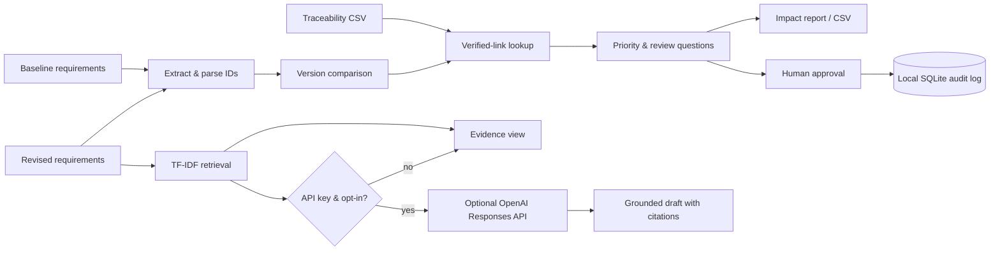

# Architecture and engineering decisions

## Data flow

## Key decisions

1. **Source of truth:** Stable `REQ-###` IDs; no hidden fuzzy identity matching. An ID rename will appear as deletion/addition.
2. **Link provenance:** System, user story, and test case associations are only treated as *verified* if supplied in traceability CSV. An empty link list is not evidence of no impact.
3. **Retrieval:** TF-IDF (1-2 grams) is small, interpretable, quick and works offline. Not an embedding-based vector database. It may miss paraphrases and synonyms.
4. **Generation:** Optional OpenAI Responses API receives only top-ranked requirement excerpts. Outputs are labeled drafts, with citations checked for membership in retrieved IDs, not audited for factual accuracy.
5. **Human in the loop:** Manual reviewer actions are retained in local SQLite scoped to a digest of the input workspace, not authenticated or suited to public multi-user deployment.
6. **Risk prioritization:** Transparent keyword-and-missing-link heuristic only. It is not compliance assurance, fraud prediction, or a validated risk classifier.
7. **Sample scope:** Data is completely fictional and deliberately engineered to create verifiable test cases.

## Production upgrade path

- Per-project workspace IDs with encrypted file and vector storage; isolated reviewer records and authentication.
- OCR plus requirement extraction with confidence scoring and manual ID resolution.
- Hybrid semantic + lexical retrieval, evaluation across more realistic independent corpora.
- Add version-pinned acceptance criteria and graph-based transitive traceability.
- Introduce role-based approvals, change-version hashes, audit export, external ticket integrations.
- Apply data retention controls and formal data-processing review before enterprise use.
